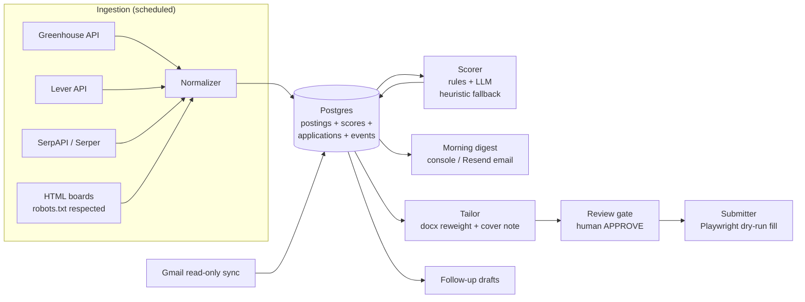

# Job Hunt Engine

A multi-lane, LLM-scored job-search engine that runs a disciplined executive
search as a *pipeline*, not a tab hoard. It aggregates openings from public
job-board APIs and search, scores each posting against per-lane fit profiles,
drafts tailored resume variants and cover notes, pre-fills application forms
for human review, and tracks the full funnel — including recruiter email
threads — in Postgres.

Built for two lanes (Data & AI executive, Wellness executive) but the lane
config is just YAML; the machinery is lane-agnostic.

## Why it exists

Executive searches fail from volume without triage: hundreds of postings,
most irrelevant, and no memory of what was said to whom. This engine applies
the same discipline a VP of Data would apply to any pipeline — structured
ingestion, transparent scoring rules with an LLM layer, stage tracking, and
exception review — to the search itself. Scoring is explainable: every score
carries a per-criterion rationale, so a human can always answer "why did this
posting surface?"

## Architecture



Pipeline stages: `targeted → tailored → approved → submitted → screening →
interview → offer / rejected / withdrawn`, with an event log per application.

## Guardrails (deliberate, enforced in code)

- **Human-in-the-loop by design.** The engine prepares; the candidate
  approves and presses submit. Tailoring, follow-ups, and stage changes are
  drafts until a human confirms (`engine/main.py` approval gate).
- **No automated LinkedIn actions.** LinkedIn URLs are opened in the
  candidate's own browser session; nothing is clicked or sent there
  (`engine/submitter/linkedin_assist.py`).
- **No fabrication.** Resume tailoring only reorders and rephrases
  within bounds from a verified master resume; cover notes must use provided
  highlights only (`engine/tailor/`).
- **Respect robots.txt** on HTML boards; 1 req/sec ceiling on all fetching.
- **Read-only email scope** (`gmail.readonly`); no auto-replies, no auto-send.

## Stack

Python 3.12+ · Postgres · Playwright (form fill) · python-docx (resume
tailoring) · OpenAI-compatible LLM API (Kimi/Moonshot) with deterministic
heuristic fallback · Resend (email) · Gmail API (read-only thread tracking) ·
pytest

## Quick start

```bash
cd job-hunt-engine
python3 -m venv .venv && source .venv/bin/activate
pip install -e '.[dev]'          # add '.[gmail]' for email tracking; playwright install chromium for form-fill

cp .env.example .env             # fill in DATABASE_URL at minimum
createdb jobhunt                 # local dev; or point DATABASE_URL at any Postgres
python -m engine.main init-db
python -m engine.main seed       # known-good acceptance rows
python -m engine.main aggregate  # live pull from Greenhouse/Lever (+ SerpAPI if keyed)
python -m engine.main score      # rules + LLM/heuristic scoring, all lanes
python -m engine.main digest     # morning digest (console; emailed with RESEND_API_KEY)
pytest
```

Daily loop:

```bash
python -m engine.main target <posting_id>   # from digest — opens an application
python -m engine.main tailor <app_id>       # tailored resume + cover note -> artifacts/
python -m engine.main review <app_id>       # approval gate — type APPROVE
python -m engine.main submit <app_id>       # dry-run form fill (screenshot); --no-dry-run when ready
python -m engine.main status                # pipeline snapshot
```

To use tailoring, place master resumes at
`engine/tailor/resume_template_data_ai.docx` and
`engine/tailor/resume_template_wellness.docx` (names configurable per lane in
`config/profile*.yaml`).

Only `DATABASE_URL` is required. Without API keys the engine still runs:
aggregated web search is skipped (Greenhouse/Lever remain), scoring falls
back to deterministic heuristics, and the digest prints to console. See
`.env.example` for the full list.

## Layout

| Path | Role |
|---|---|
| `engine/aggregator/` | Greenhouse/Lever APIs, SerpAPI/Serper search, HTML boards, normalizer |
| `engine/matcher/` | Scoring: kill criteria, tiered salary floors, fit signals, rationale |
| `engine/llm.py` | LLM client + heuristic fallback + cover-note writer |
| `engine/tailor/` | docx reweighting (reorder/rephrase-within-bounds) + cover notes |
| `engine/submitter/` | Playwright form fill (dry-run default), LinkedIn open-only assist |
| `engine/tracker/` | Funnel, Gmail read-only thread sync, follow-up drafts |
| `engine/notify/` | Morning digest |
| `config/` | Per-lane profiles, watchlists, scoring thresholds, query rotation |
| `db/` | Schema + migrations |
| `tests/` | Unit tests (no live API calls) |
| `scripts/` | Cron wrappers + Excel tracker export |

`Job_Hunt_Engine_Spec.md` and `Job_Hunt_Engine_Wellness_Addendum.md` are the
original build specs — including acceptance criteria the implementation is
tested against.

## Status: portfolio

Provided for review as a sample of systems thinking and end-to-end delivery
(spec → schema → ingestion → scoring → guardrailed automation → tests).
Not licensed for production use; no warranty or support is offered.
